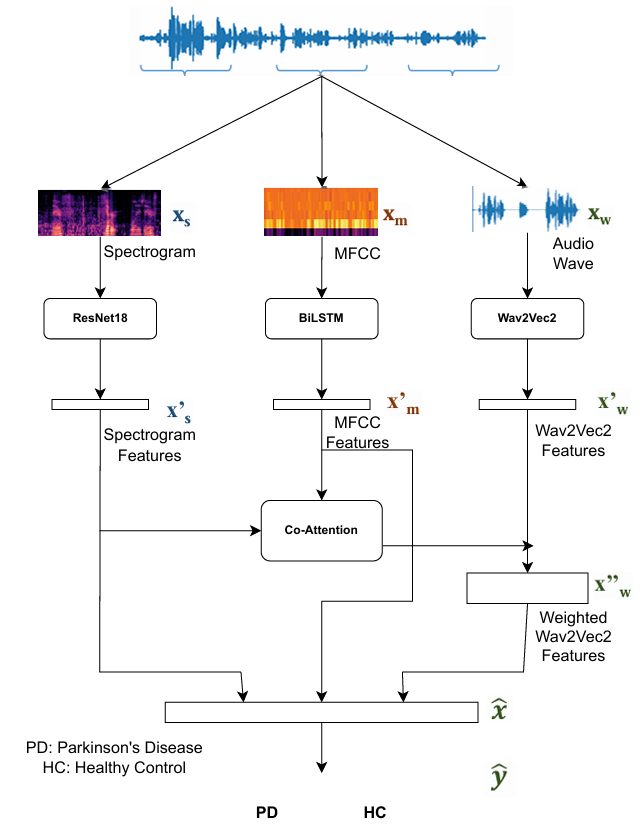
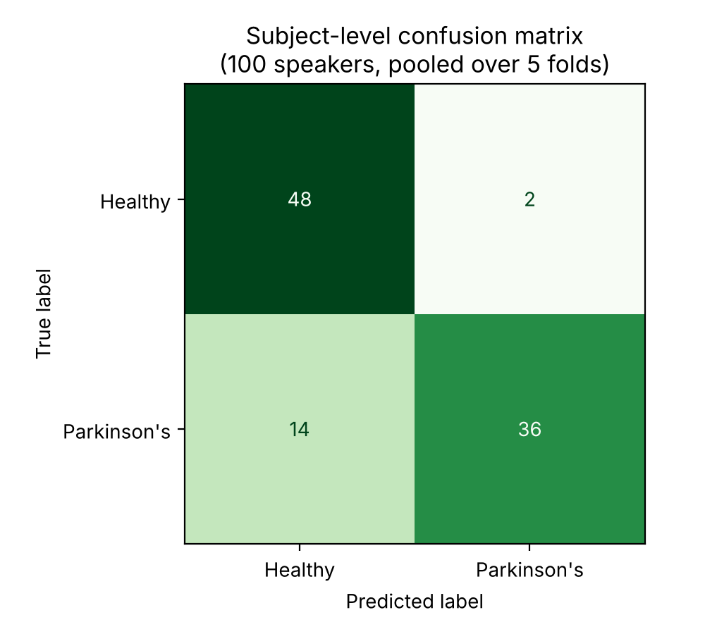
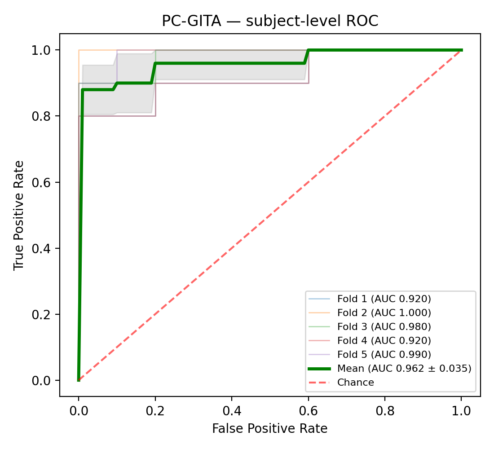

# Parkinson's Disease Detection from Speech (PC-GITA)

A multi-branch deep learning model that detects Parkinson's disease (PD) from connected Spanish speech.
It combines three views of the same 5-second speech segment: a **spectrogram image** (ResNet-18), an
**MFCC sequence** (BiLSTM) and **self-supervised Wav2Vec 2.0 embeddings**. A **co-attention** mechanism
uses the first two to decide which Wav2Vec2 frames matter most.

This repository contains the PC-GITA experiment from my diploma thesis *"Parkinson's Disease Detection
Using Speech"* (National Technical University of Athens, 2026). It is evaluated with a strict
**speaker-independent** protocol, so no speaker ever appears in both training and test data.

<p align="center"></p>

## Results

Subject-level results with nested 5-fold speaker-independent cross-validation on PC-GITA
(50 PD + 50 healthy speakers, Read Text + Monologue). The model was trained with **5 random seeds**,
using the same outer test folds each time. Each seed's metrics are the mean over its 5 folds. The table shows
**mean ± std across the 5 seeds**.

| Early stopping | Accuracy | Recall (sensitivity) | Specificity | F1 | AUC |
|---|---|---|---|---|---|
| **Subject-level F1 (main protocol)** | **86.4% ± 2.4** | **80.8% ± 5.2** | **92.0% ± 4.0** | **84.5% ± 3.5** | **0.962 ± 0.009** |
| Validation loss (ablation) | 83.8% ± 2.7 | 74.8% ± 5.4 | 92.8% ± 3.6 | 80.3% ± 4.2 | 0.959 ± 0.014 |

Per-seed numbers: [`results/multiseed_summary.csv`](results/multiseed_summary.csv).

**Which speech task helps more?** These numbers come from the seed-42 run. The same models were evaluated
on only one task's segments per speaker:

| Speech used at test time | Accuracy | AUC |
|---|---|---|
| Read Text only | 77.0% ± 12.9 | 0.900 ± 0.049 |
| Monologue only | 84.0% ± 11.6 | 0.946 ± 0.052 |
| **Both (default)** | **84.0% ± 10.2** | **0.962 ± 0.035** |

Spontaneous speech (monologue) is more informative than reading, and combining both tasks gives the best ranking (AUC).

### Main run (seed 42)

| Fold | Accuracy | Precision | Recall | Specificity | F1 | AUC |
|---|---|---|---|---|---|---|
| 1 | 85.0% | 81.8% | 90.0% | 80.0% | 85.7% | 0.920 |
| 2 | 95.0% | 100.0% | 90.0% | 100.0% | 94.7% | 1.000 |
| 3 | 75.0% | 100.0% | 50.0% | 100.0% | 66.7% | 0.980 |
| 4 | 70.0% | 100.0% | 40.0% | 100.0% | 57.1% | 0.920 |
| 5 | 95.0% | 100.0% | 90.0% | 100.0% | 94.7% | 0.990 |
| **Mean ± std** | **84.0% ± 10.2** | **96.4% ± 7.3** | **72.0% ± 22.3** | **96.0% ± 8.0** | **79.8% ± 15.3** | **0.962 ± 0.035** |

<p align="center">
  
  
</p>

**Takeaways and limitations**
- The model separates PD from healthy speakers well (AUC ≈ 0.96). With the default 0.5 threshold it is
  **conservative**: specificity is higher than sensitivity, and most errors are PD speakers classified as healthy.
- With 20 test speakers per fold, one speaker equals 5% accuracy, so per-fold variance is high. Some PD speakers
  (mostly in fold 4) are missed in almost every run.
- PC-GITA is small (100 speakers, one language, one recording setup). Generalization to other corpora is not shown here.

### Note on the thesis numbers

The thesis reports 89.0% accuracy and 0.959 AUC. While preparing this repository I found a bug in the original
preprocessing. Speaker IDs were parsed with `filename.split("_")`, which failed for the monologue files
(`AVPEPUDEA0001-Monologo-NR.wav`). Each speaker was therefore counted as two different "subjects", one per task,
and the read-text and monologue recordings of the same person could end up in different folds.

This repository fixes the bug: IDs are parsed with a regex, and the code asserts that there are exactly 50 + 50
speakers and no overlap between splits. All results above use the corrected pipeline. The thesis code also
fine-tuned the Wav2Vec2 Transformer layers, whereas here Wav2Vec2 is **fully frozen**, as described in the thesis
text. The core result held up: accuracy is slightly lower (86.4% vs 89.0%) and the AUC is unchanged (0.962 vs 0.959).

## Method

**Preprocessing.** Read Text (*"ayer fui al médico…"*) and Monologue recordings, unnormalized version.
Each recording is converted to mono, resampled to 16 kHz and cut into non-overlapping 5 s chunks. The last chunk
is zero-padded, or dropped if it is shorter than 2.5 s. This gives 1,306 chunks from 100 speakers.

**Three branches per chunk**
| Branch | Input | Encoder | Output |
|---|---|---|---|
| Spectrogram | log-Mel (200 bands, 40 ms window, 10 ms hop) + Δ + ΔΔ as a 3-channel 224×224 image, ImageNet-normalized | ResNet-18 (ImageNet-pretrained) | 512-d |
| MFCC | 40 MFCCs × 501 frames | BiLSTM (64 units per direction) + linear | 128-d |
| Raw audio | 80,000-sample waveform | Wav2Vec2 XLSR-53 (Spanish), **frozen** | 249 × 1024 frames |

**Co-attention fusion.** The spectrogram and MFCC vectors form a 640-d *global context*, which is projected to a
128-d query. Each Wav2Vec2 frame is projected to a 128-d key. Dot-product attention with softmax weights the
frames, and their weighted sum (1024-d) is concatenated with the global context (1664-d). An MLP
(1664 → 64 → 2, dropout 0.2) produces the chunk-level prediction.

**Evaluation protocol**
- **Outer loop:** 5 folds, stratified and grouped by speaker. Every speaker (both tasks) is in exactly one test
  fold. The fold assignment is fixed in [`splits/pcgita_outer_folds.csv`](splits/pcgita_outer_folds.csv).
- **Inner split:** 15% of the training speakers are held out *only* for early stopping (patience 3, max 15
  epochs). The outer test fold is used once, at the end.
- **Subject-level diagnosis:** chunk probabilities are averaged per speaker and thresholded at 0.5.
- Adam (lr 1e-4), batch size 64, cross-entropy loss, gradient clipping at 1.0. Fully seeded: re-running seed 42
  on the same chunk files reproduced the main run exactly. Regenerating the chunks from scratch can change the row
  order, and therefore the batch order, so expect small differences in that case.

## Repository structure

```
├── main.py                    # CLI: prepare | extract | train | evaluate
├── src/
│   ├── config.py              # audio, feature and training settings
│   ├── preprocess.py          # task selection, resampling, 5 s chunking, speaker IDs
│   ├── features.py            # Wav2Vec2 feature caching, spectrogram and MFCC computation
│   ├── models.py              # ResNet-18 / BiLSTM / co-attention model
│   ├── cv.py                  # nested speaker-independent cross-validation
│   └── evaluate.py            # subject-level metrics, multi-seed summary, plots
├── splits/pcgita_outer_folds.csv
├── notebooks/run_on_colab.ipynb
├── results/                   # metrics and figures reported above
└── docs/architecture.png
```

## Reproducing the results

### 1. Get the data
PC-GITA is not included and cannot be redistributed. It is available on request from the GITA Lab,
Universidad de Antioquia (Orozco-Arroyave et al., 2014). Keep the original folder layout:
```
<PCGITA_ROOT>/read text/ayerfuialmedico/sin normalizar/{hc,pd}/*.wav
<PCGITA_ROOT>/monologue/sin normalizar/{hc,pd}/*.wav
```

### 2. Run
```bash
pip install -r requirements.txt

python main.py prepare  --raw-dir <PCGITA_ROOT> [--metadata <PCGITA_metadata.xlsx>]
python main.py extract                                   # frozen Wav2Vec2 features (~1 min on a T4)
python main.py train    --seeds 42 1 2 3 4 --es f1       # add "--es f1 loss" for the ablation
python main.py evaluate
```
Outputs go to `outputs/runs/es_<criterion>_seed<seed>/`: per-fold predictions, logs, metrics and plots.
Training is resumable, so finished folds are skipped.

The whole pipeline runs on a free Colab T4 in about 15–20 minutes. See
[`notebooks/run_on_colab.ipynb`](notebooks/run_on_colab.ipynb).

## Citation

```bibtex
@mastersthesis{theodosiou2026pd,
  author = {Theodosiou, Georgios},
  title  = {Parkinson's Disease Detection Using Speech},
  school = {National Technical University of Athens, School of Electrical and Computer Engineering},
  type   = {Diploma thesis},
  year   = {2026},
  note   = {In Greek. Supervisor: Prof. Dimitrios Askounis}
}
```

## References
- J. R. Orozco-Arroyave, J. D. Arias-Londoño, J. F. Vargas-Bonilla, M. C. González-Rátiva, E. Nöth.
  *New Spanish speech corpus database for the analysis of people suffering from Parkinson's disease.* LREC 2014.
- Y. Shao, T. Fang. *Alzheimer's Disease Detection Using Co-Attention Mechanism for Acoustic and ASR-Transcribed
  Text Features*, 2025. This was the inspiration for the co-attention fusion.
- A. Conneau et al. *Unsupervised Cross-lingual Representation Learning for Speech Recognition* (XLSR-53), 2020.

## License
Code: MIT (see [LICENSE](LICENSE)). PC-GITA data is subject to its own license and is not distributed here.
